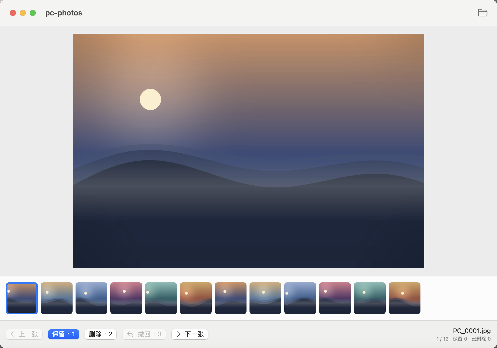
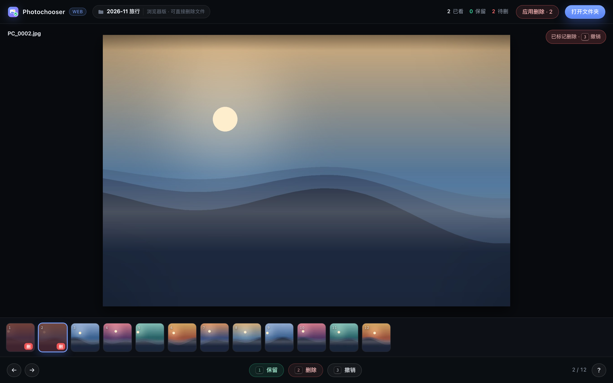

# Photochooser

**把一堆照片，快速筛成几张。** 三键完成：`1` 保留、`2` 标记删除、`3` 撤销。

macOS、Windows、浏览器三种用法，同一套交互。



## 下载

| 平台 | 文件 | 说明 |
| --- | --- | --- |
| macOS 14+ | [Photochooser-1.0.0-universal.dmg](https://github.com/logex-linux/photochooser/releases/latest/download/Photochooser-1.0.0-universal.dmg) | Apple Silicon + Intel 通用包 |
| Windows 10/11 x64 | [Photochooser-1.0.0-windows-x64.zip](https://github.com/logex-linux/photochooser/releases/latest/download/Photochooser-1.0.0-windows-x64.zip) | 解压后运行 `Photochooser.exe`，删除进回收站 |
| 任意浏览器 | [photochooser.html](https://github.com/logex-linux/photochooser/releases/latest/download/photochooser-1.0.0.html) | 单文件，双击打开，无需安装 |

首次打开：

- **macOS** 是 ad-hoc 签名、未公证。若提示「无法验证开发者」，右键 App → 打开；或执行
  `xattr -dr com.apple.quarantine /Applications/Photochooser.app`。
- **Windows** 没有代码签名。SmartScreen 提示时点「更多信息」→「仍要运行」。
- **HTML** 建议用 Chrome / Edge：它们支持直接删除文件；Safari、Firefox 只能标记，不能删。

## 怎么用

1. 打开文件夹（或直接把文件夹拖进窗口）。
2. 用键盘过一遍：
   - `1` 保留这张，下一张
   - `2` 标记删除，下一张（不会立刻删）
   - `3` 撤销上一次标记
   - `←` `→` 上一张 / 下一张
3. 点右上角「应用删除」，一次性把标记的照片移到废纸篓 / 回收站。

底部的胶片条可以直接点任意一张跳过去，标了删除的会变暗并带红色「删」角标。



## 性能做了什么

旧版每次翻页都在主线程同步解码整张原图，一张 48MP 的照片足够卡半秒。现在：

**macOS（Swift / ImageIO）**

- 用 `CGImageSourceCreateThumbnailAtIndex` 在后台降采样解码到 2000px，内存里不会出现全尺寸位图
- 当前图 + 相邻两张预取，方向键翻页直接命中缓存
- 6 张预览的 LRU 缓存，缩略图单独缓存 800 张
- 快速连按时取消上一个解码任务，只渲染最新一张
- 文件夹扫描放到后台，界面不冻结
- 胶片条用 `LazyHStack`，缩略图进入可视区才解码

**Web / Windows（Chromium）**

- 两个 Worker 分别处理预览和缩略图，主线程不碰解码
- 先读 JPEG/PNG/WebP/AVIF 文件头拿到尺寸，再让浏览器按目标尺寸解码，避免整图解码
- 预览用单个 `<canvas>` 绘制，不做 DOM 图片切换
- 6 张 LRU + 相邻预取；缩略图用 `IntersectionObserver` 懒加载
- 快速翻页时丢弃过期结果，队列里当前图优先于预取

## 三端差异

| | macOS | Windows | 浏览器 |
| --- | --- | --- | --- |
| 解码 | ImageIO | Chromium | Chromium |
| HEIC / HEIF / HIF | ✅ | ❌ | ❌ |
| JPG / PNG / WebP / AVIF / GIF | ✅ | ✅ | ✅ |
| 删除 | 废纸篓 | 回收站 | Chrome/Edge 直接删；其他浏览器只读 |
| 需要安装 | 是 | 是（绿色版） | 否 |

浏览器和 Windows 版跳过 HEIC 时会提示数量，这类照片请用 macOS 版处理。

## 从源码构建

需要 Xcode 16+ / Swift 6、Node 20+。

```bash
swift test                      # macOS 单元测试
./script/build_dmg.sh           # dist/Photochooser-<版本>-universal.dmg
./script/build_web.sh           # dist/photochooser.html + web/dist/web/
./script/build_windows.sh       # dist/Photochooser-<版本>-windows-x64.zip
./script/build_all.sh           # 三个一起
```

Windows 包由 Electron 壳 + 同一套 Web 资源组成，在 macOS/Linux 上即可交叉打包，不需要 Wine。
国内网络可以给 Electron 下载加镜像：

```bash
ELECTRON_MIRROR=https://npmmirror.com/mirrors/electron/ ./script/build_windows.sh
```

### 测试

```bash
swift test
node --test web/tests/core.test.mjs
python3 web/tests/ui-smoke.py   # 需要 playwright + chromium
```

`ui-smoke.py` 会启动本地静态服务，用 Playwright 跑一遍选图、键位、撤销、模拟目录句柄删除，
再验证单文件 HTML 能独立解码。

## 目录结构

```
Sources/Photochooser/      macOS App（SwiftUI + Observation）
  App/                     入口与菜单快捷键
  Stores/PhotoStore.swift  选图、删除、撤销、预取调度
  Imaging/                 ImageIO 降采样解码 + LRU 缓存
  Views/                   预览、胶片条、控制栏
web/src/                   共享 Web UI（core / source / worker / app）
desktop/                   Windows 的 Electron 外壳（原生选目录、回收站）
script/                    图标、App、DMG、Web、Windows 构建脚本
Tests/                     Swift 测试
```

## 已知限制

- macOS 包未做 Apple 公证，Windows 包未做代码签名，首次运行需要手动放行。
- Web 版只能读文件夹第一层的照片，和桌面版行为一致。
- 浏览器无法解码 HEIC，会直接跳过并提示。
- 浏览器删除是永久的；只有 Chrome/Edge 通过 File System Access 才能删，其他浏览器为只读。

## License

[MIT](LICENSE)
